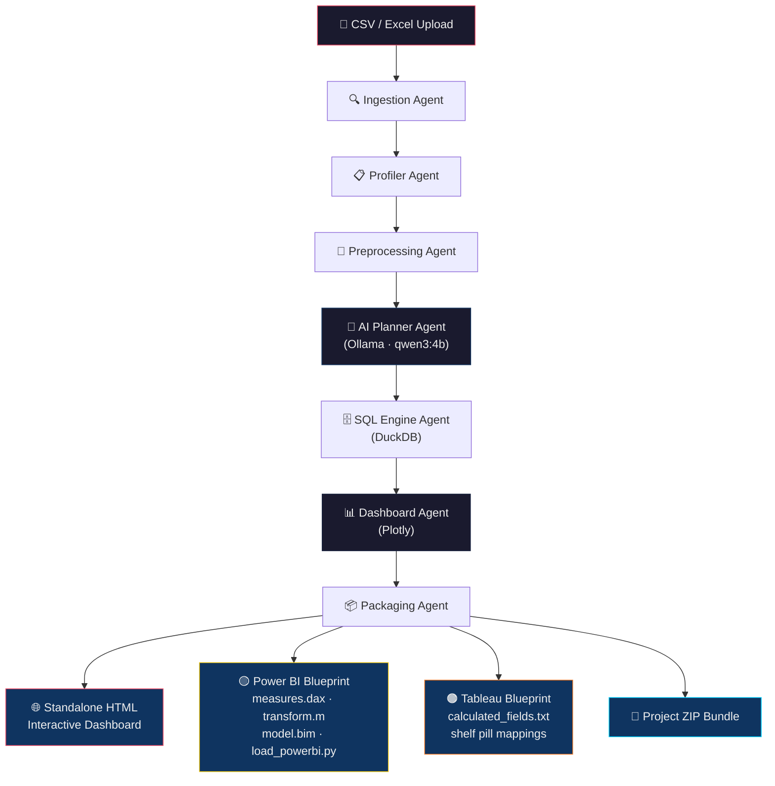

# ⚡ DashForge — Agentic AI Dashboard Generator


Welcome to **DashForge** — an autonomous multi-agent data intelligence platform. Upload any CSV/Excel dataset and DashForge will profile it, clean it, plan a multi-sheet executive dashboard, generate interactive Plotly visualizations, and export standalone HTML dashboards alongside copy-paste blueprints for **Power BI** and **Tableau**.

## 📊 Overview

DashForge analyzes your data end-to-end through a pipeline of specialized AI agents, delivering:
- **Data Profiling & Quality Scoring**: Automated schema inference, null/duplicate detection, and data quality scoring.
- **Smart Preprocessing**: Intelligent type casting, deduplication, and missing-value imputation.
- **AI-Planned Dashboards**: An LLM agent architects multi-sheet dashboard layouts tailored to your data's business dimensions and KPIs.
- **Interactive Visualizations**: Live Plotly charts with pan, zoom, hover tooltips, and multi-sheet tab navigation.
- **BI Tool Replication Blueprints**: Production-ready DAX measures, Power Query M scripts, and Tableau calculated fields with step-by-step visual mapping guides.


## 🏗️ Multi-Agent Architecture



## 📁 Repository Contents

```
Data_Analyst_Agent/
├── README.md                   # This file
├── .gitignore                  # Git ignore rules
└── dashforge/                  # Main application
    ├── .env                    # Environment config (Ollama URL, model, limits)
    ├── requirements.txt        # Python dependencies
    ├── start_all.bat           # 1-Click launcher (backend + frontend)
    ├── run_backend.bat         # FastAPI backend launcher (Port 8001)
    ├── run_frontend.bat        # Streamlit frontend launcher (Port 8502)
    ├── backend/
    │   ├── api.py              # FastAPI REST endpoints
    │   ├── config.py           # Pydantic settings & environment management
    │   ├── database.py         # DuckDB analytical database engine
    │   ├── models.py           # Data models and schemas
    │   ├── orchestrator.py     # Multi-agent pipeline controller
    │   ├── llm_service.py      # Local Ollama LLM provider
    │   └── agents/
    │       ├── ingestion_agent.py      # File parsing & validation
    │       ├── profiler_agent.py       # Data profiling & quality scoring
    │       ├── preprocessing_agent.py  # Data cleaning & transformation
    │       ├── planner_agent.py        # AI dashboard architecture planner
    │       ├── sql_agent.py            # SQL code generation & execution
    │       ├── dashboard_agent.py      # Plotly interactive dashboard engine
    │       ├── powerbi_agent.py        # Power BI DAX & M asset generator
    │       ├── tableau_agent.py        # Tableau calculated fields & blueprints
    │       ├── codegen_agent.py        # Python & SQL code generator
    │       └── packaging_agent.py      # Bundle packaging (.ZIP)
    ├── frontend/
    │   └── app.py              # Streamlit multi-step web application
    ├── data/
    │   ├── uploads/            # Uploaded dataset staging
    │   └── exports/            # Generated output bundles and dashboards
    └── samples/                # Reference templates and test files
```

## 🚀 Key Features

1.  **Standalone Interactive HTML Dashboard**
    - Zero vendor lock-in: generates a self-contained `.html` file with dark executive styling, responsive multi-sheet tabs, KPI metric cards, and interactive Plotly charts.
    - Usable completely offline in any modern web browser.

2.  **Native In-App Visualization**
    - Live Plotly charts rendered directly inside DashForge with pan, zoom, hover tooltips, and box-select.

3.  **Power BI Replication Blueprint**
    - Production-ready `measures.dax` (safe DAX formulas using `DIVIDE`, `COALESCE`, `SUMX`).
    - Power Query `transform.m` script and Tabular model schema `model.bim`.
    - Python connector script `load_powerbi.py` and step-by-step visual mapping guide.

4.  **Tableau Replication Blueprint**
    - Production-ready calculated fields (`calculated_fields.txt` and `.json`).
    - Step-by-step shelf pill mappings (Columns, Rows, Color, Marks) for each visual sheet.

5.  **Local & Private LLM Inference**
    - Powered by local Ollama (`qwen3:4b` or any compatible model). No data leaves your machine.

## 🛠️ Technology Stack

| Layer | Technology |
| :--- | :--- |
| **Backend API** | Python, FastAPI, Uvicorn |
| **Frontend UI** | Streamlit |
| **Database Engine** | DuckDB (in-process OLAP) |
| **Data Processing** | Pandas, NumPy, SciPy |
| **Visualization** | Plotly, Matplotlib |
| **LLM Inference** | Ollama (local, private) |
| **BI Exports** | Power BI (DAX / M / BIM), Tableau (Calculated Fields) |
| **Reporting** | ReportLab, Jinja2, lxml |

## 💻 Getting Started

### Prerequisites
- **Python 3.11+**
- **Ollama** installed and running locally with a model pulled:
  ```bash
  ollama run qwen3:4b
  ```

### Installation
1. Clone the repository:
   ```bash
   git clone https://github.com/shyam10102005/Data_Analyst_Agent.git
   cd Data_Analyst_Agent/dashforge
   ```
2. Create a virtual environment and install dependencies:
   ```bash
   python -m venv .venv
   .venv\Scripts\activate       # Windows
   pip install -r requirements.txt
   ```

### Launch
Double-click `start_all.bat` or run:
```powershell
.\start_all.bat
```

Or start services individually:
```powershell
.\run_backend.bat    # FastAPI backend → http://localhost:8001/docs
.\run_frontend.bat   # Streamlit UI    → http://localhost:8502
```

## 📊 End-to-End Workflow

1. **Upload** — Drag and drop CSV or Excel files.
2. **Preferences** — Choose output targets (Power BI, Tableau, or Both) and theme preset (Corporate Blue, Modern Dark, Vibrant, etc.).
3. **Ingestion & Profiling** — Automated quality scores, missing values, duplicates, and semantic types.
4. **Preprocessing** — Automated cleaning rules and data type standardization.
5. **AI Planning** — The AI agent creates a multi-sheet architecture tailored to your data's business dimensions and metrics.
6. **SQL & Analysis** — Automated SQL query execution and verification against DuckDB.
7. **Dashboard & Blueprints** — Interact with live charts, download the standalone `.html` dashboard, copy DAX/M/Tableau assets, and download the complete `.zip` bundle.

## 📄 License

This project is for analytical and educational purposes.
